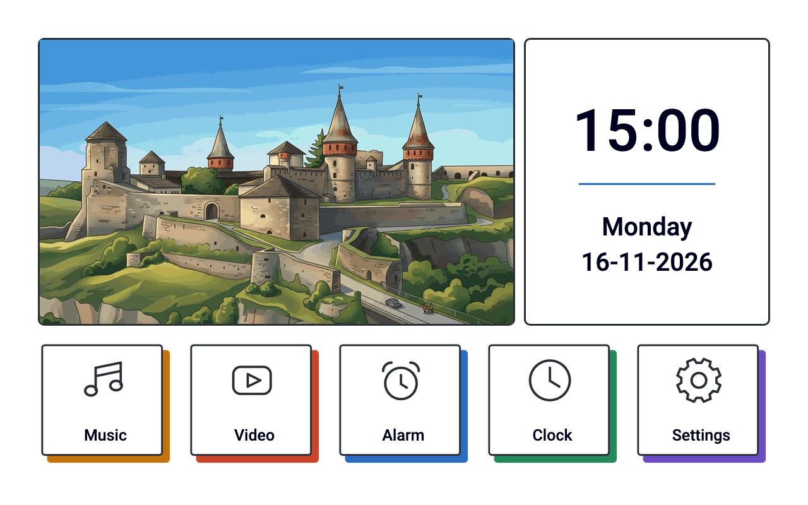
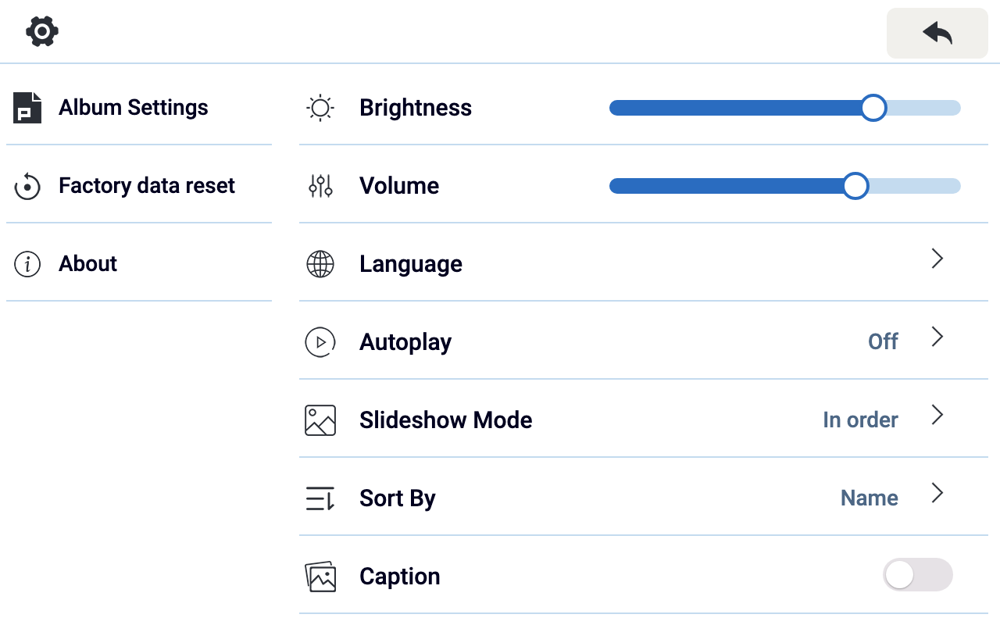

# Firmware mod for the 10.1-inch Digital Calendar with Schedule Management (HY-XKSZ-10.1)

Photo frame / digital calendar on the **YD_F102_MIPI_V3.0** board (Allwinner F102, Melis RTOS). Case label: **10.1-inch Digital Calendar with Schedule Management, Model: HY-XKSZ-10.1**.

Custom firmware images for photo frames built on the **YD_F102_MIPI_V3.0** board (Allwinner F102, Melis RTOS), plus the original seller firmware, everything needed to flash it (PhoenixSuit, the USB driver, a step-by-step guide) and the tools used to build the images.

The mod gives the frame a light interface, adds the **Ukrainian** language and fixes a number of unreadable screens. It also contains a fix that makes frames with an **HT101D08S / JDH328DK0** screen work, which did not start with the seller's firmware (static colour stripes).

| Main menu | Settings |
|---|---|
|  |  |

> The pictures are **preview renders** assembled from the firmware's own image files and the screen layout read from its code. They are not photos of a device. More screens and details: [docs/FEATURES.md](docs/FEATURES.md).

## Which devices is this for?

The original label on the back of the case reads:

> 10.1-inch Digital Calendar with Schedule Management
> Model: HY-XKSZ-10.1

Inside such a device the author found the **YD_F102_MIPI_V3.0** board (Allwinner F102 processor, SPI NOR flash XM25QH64C, GSL1680 touch controller) with a 10.1-inch 800×1280 MIPI panel. If your device carries this label, or you opened it and see the same board, this repository is for you. Whether the case label differs between the panel variants below is not known, so do **not** use it to choose the image; use the panel marking or the test in [Identify your frame](docs/IDENTIFY_YOUR_FRAME.md).

Search terms: HY-XKSZ-10.1, 10.1 inch digital calendar, schedule management photo frame, YD_F102_MIPI_V3.0, Allwinner F102, Melis, PhoenixSuit, smartframe.img.

## Which file do I need?

Frames with this board come with **different LCD panels**, and the panel decides which image works. Two variants are known:

| Hardware variant | Panel marking | Stock seller firmware | Custom mod |
|---|---|---|---|
| **A** | `K101-IM2CYL02-L` | works | [`custom/variant-a_k101-im2cyl02-l`](firmware/custom/variant-a_k101-im2cyl02-l) |
| **B** | `HT101D08S` / `JDH328DK0` (flex cable marking `SY31P 2021.11.15`) | **does not work** (static stripes) | [`custom/variant-b_ht101d08s`](firmware/custom/variant-b_ht101d08s) |

Not sure which one you have? Read **[Identify your frame](docs/IDENTIFY_YOUR_FRAME.md)**. In short: open the back cover and read the panel marking, or flash variant A first (it is harmless on variant B; you will just see stripes) and look at the screen.

**Never flash the variant B image on a variant A frame or the other way round.** In the author's experience a wrong image does not stop the frame from being flashed again (the flashing mode is built into the processor; more than twenty test images, including ones with a black screen, were replaced without problems), but the screen stays broken until you flash the right one.

## Firmware images

| Image | For | SHA-256 |
|---|---|---|
| [`firmware/stock/seller-2026-10-16`](firmware/stock/seller-2026-10-16) | original, unmodified seller image (variant A only) | `f9ed6a46a22f82b71cb6fe63e1f3ce9ac780665fbb0c1967e694c43a7c593fa0` |
| [`firmware/custom/variant-a_k101-im2cyl02-l`](firmware/custom/variant-a_k101-im2cyl02-l) | custom mod, variant A | `784eb0582048ad1a203c709ab5a0a38d32758380b527c8732ec7ac9d36036d81` |
| [`firmware/custom/variant-b_ht101d08s`](firmware/custom/variant-b_ht101d08s) | custom mod, variant B | `33c979a951969a9bc11d1043bcdebf07d3597e21359ef17ea8f766df2415f25b` |

Each folder contains one file, `smartframe.img`. More about the options: [firmware/README.md](firmware/README.md).

## How to install

Full step-by-step guide: **[docs/UPDATING.md](docs/UPDATING.md)**. The short version:

1. Identify your hardware variant and take the matching `smartframe.img`.
2. On a Windows PC install the USB driver and start PhoenixSuit; both are in [`flashing-tools/`](flashing-tools).
3. Select the image, choose the full-erase mode, put the frame into flashing mode (hold **Power** while plugging the USB cable in) and wait for the success message.
4. Set the language in Settings.

**Warning.** Flashing uses the *full erase* mode, which wipes the frame's internal flash, including all settings and any data stored there. There is no way to back up that flash with these tools. Use at your own risk; read the guide first.

## Status

| Item | Status |
|---|---|
| Stock image on a variant A frame | confirmed working |
| Custom mod, variant A | confirmed working on the author's frame |
| Custom mod, variant B | confirmed working on the author's frame (16 Nov 2026) |
| Stock image on a variant B frame | does not work (stripes) |
| Other panels using the same board | unknown: reports welcome |
| One image for both variants | not available yet, see [Identify your frame](docs/IDENTIFY_YOUR_FRAME.md#one-image-for-both-variants) |

## Documentation

- [Identify your frame](docs/IDENTIFY_YOUR_FRAME.md): hardware variants and how to tell them apart.
- [Updating the firmware](docs/UPDATING.md): complete flashing guide, troubleshooting, restoring the original.
- [Flashing tools](flashing-tools): PhoenixSuit, the USB driver and the seller's demonstration video, with checksums and a safety note.
- [Features and changes](docs/FEATURES.md): what the mod changes and what it does not.
- [Panel init difference](docs/PANEL_INIT_DIFFERENCE.md): what exactly differs between the two images.
- [Technical notes](docs/TECHNICAL_NOTES.md): hardware facts, how the screen problem was solved, what was verified.
- [UART log](docs/UART.md): reading the boot log with a USB-UART adapter (optional).
- [Building images](docs/BUILDING.md): the pure-Python build kit (`build_kit/`).
- [analysis/](analysis): logs and data behind the findings.

## Rights and legal

The images are **derived from the seller's firmware** (kernel, application, resources). The original seller image is included unmodified so that you can restore it. The files in `flashing-tools/` (PhoenixSuit, the USB driver, the demonstration video) are the seller's unmodified files and belong to their authors. The repository is currently private; **before making it public the right to redistribute all of these files has to be clarified**, and the third-party files may have to be removed or replaced by download instructions.

No licence has been chosen for the scripts in `build_kit/` and `analysis_tools/` yet. The panel init tables in `build_kit/data/corpus.json` come from open drivers (Linux kernel, Seeed Studio, JieLi/Tuya, Allwinner BSP, CanMV, Milk-V and others) under their own licences; the `source` field of each table names its origin.

This is an unofficial community project with no warranty, not affiliated with the seller or the chip vendor.
