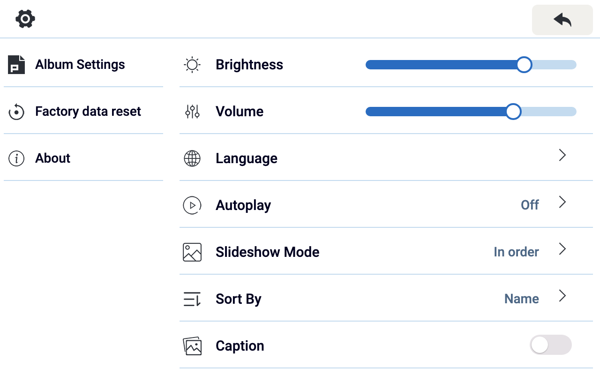
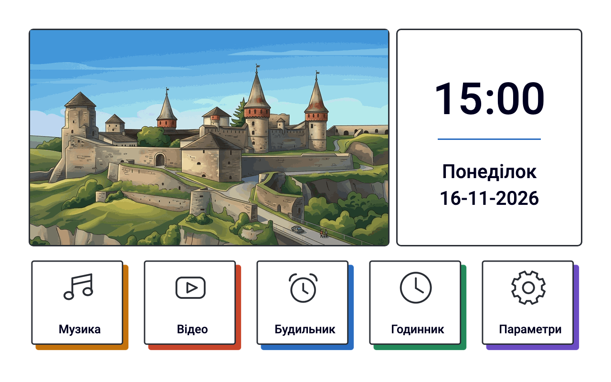
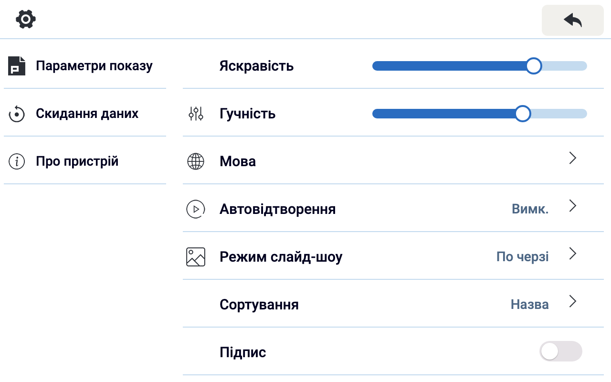
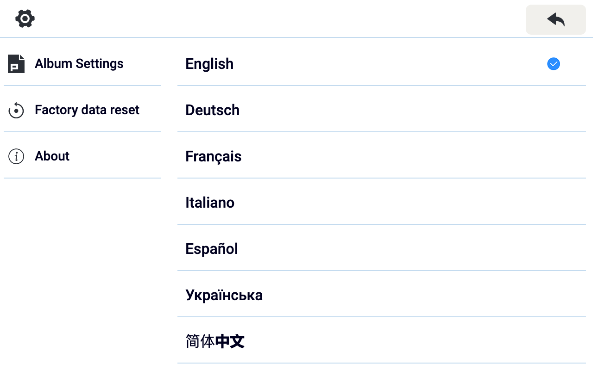

# Features and changes

What the custom images change compared with the seller's original firmware, and what they do not.

## Screens

All pictures below are **preview renders** built from the firmware's own image files; the layout was read from the firmware code. They are not photos of a device. The sample date and time are placeholders.

| | |
|---|---|
|  |  |
| Main menu (English labels) | Settings (English labels) |
|  |  |
| Main menu (Ukrainian labels) | Settings (Ukrainian labels) |
|  | |
| Language list: Ukrainian is available alongside the original languages | |

## What the mod changes

**Look**
- Light theme ("hard shadow" style): light backgrounds, dark outlines, offset coloured shadows on the five main-menu tiles (Music, Video, Alarm, Clock, Settings), dark icons.
- Main-menu tiles redrawn at 208×192 px; the selection ring is wine red (`#7B1E3F`).
- Sliders, buttons, dialogs and the "Tip" pop-up restyled for contrast on the light background.
- A different system font (Roboto-based) that covers Ukrainian letters.
- A custom welcome (boot) picture and a custom picture on the main screen. Both are the author's own artwork; replace them if you build your own variant.

**Language**
- **Ukrainian** replaces the Russian entry in the language tables (the language list shows "Українська"). Five long strings were shortened to fit. Texts that were hard-coded in Russian in the program (factory-reset dialog, restart countdown, input hint, the language name) were translated as well.
- The other languages of the original firmware are unchanged.

**Readability fixes**
- Alarm: the analogue dial's hands and ticks were white and invisible on a light background; now dark.
- Calendar: dates, the weekday row and neighbouring-month days were white on white; now readable. The highlighted day uses the wine-red accent. The default date format is DD-MM-YYYY.
- Several grey captions darkened to a readable contrast.

## What the mod does not change

- **Playback and decoding:** photo, video and music engines are the seller's.
- **Photo thumbnails:** generated by the seller's code and cached on the connected drive. They can take a long time to appear and are scaled to a fixed cell, which stretches their proportions. This is how the original firmware behaves; the mod does not touch it.
- **Dark screens:** the video player, the full-screen photo viewer and the clock screen stay black by design (the video layer is drawn by the hardware decoder). An experimental build that turned them white was not adopted.
- **Kernel:** identical to the seller's for variant A. Variant B changes only the panel init, see [PANEL_INIT_DIFFERENCE.md](PANEL_INIT_DIFFERENCE.md).
- **The seller's own Ukrainian:** the seller's later builds (29 Oct and 2 Nov 2026, see [firmware/README.md](../firmware/README.md#the-sellers-later-builds-29-oct-and-2-nov-2026)) add a Ukrainian language table of their own. This mod's Ukrainian was written separately and is installed in place of the Russian entry of the 16 Oct interface; the two translations were not compared.
- **Some English words** in dialogs (for example "Tip", "Ok", "Cancel", "Today") are hard-coded in the program and not translated; which of them are visible on screen was not fully checked.

## Compatibility

| | Variant A (`K101-IM2CYL02-L`) | Variant B (`HT101D08S`) |
|---|---|---|
| Seller's original image (16 Oct) | works | stripes |
| Seller's later builds (29 Oct, 2 Nov) | not tested | no picture / stripes |
| Custom mod | works | use the variant B image |

Hardware variants are explained in [Identify your frame](IDENTIFY_YOUR_FRAME.md).
